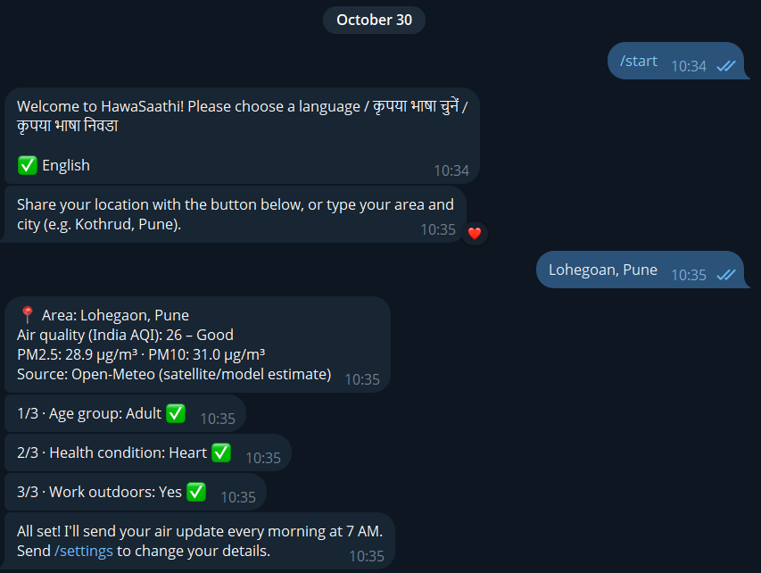
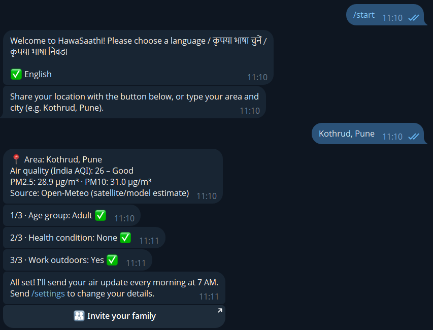
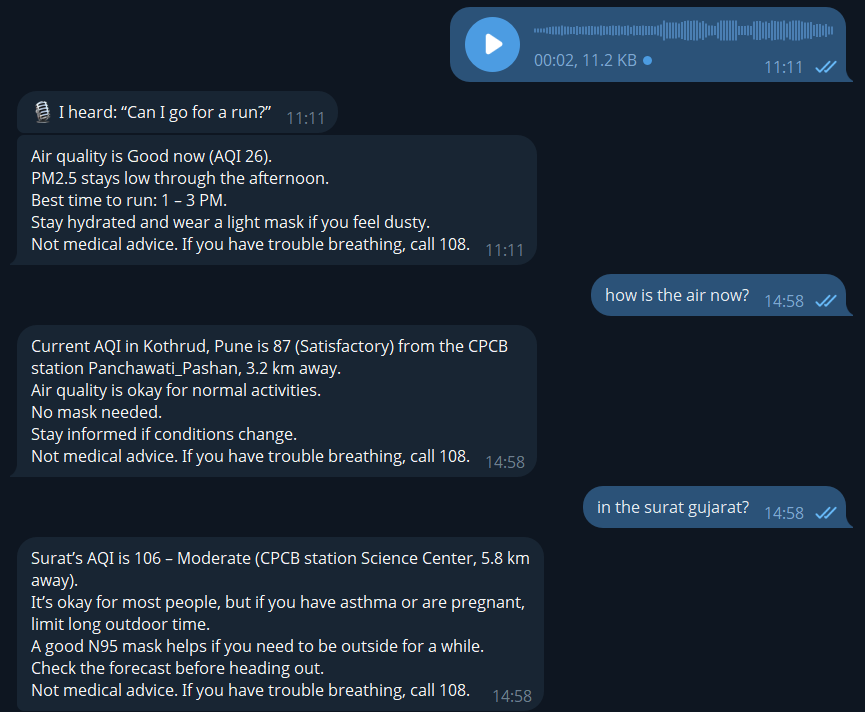

<p align="center"></p>

# HawaSaathi 🌬️

**A free Telegram assistant that tells you how clean the air is where you live, and what to do about it, in English, हिंदी or मराठी.**

Every morning it sends a local air-quality update with advice made for *you* (your age, health and work), warns you when pollution spikes, and answers questions like *"Can I go for a run now?"* or *"क्या आज बच्चे को पार्क ले जाना ठीक है?"*

- **Try it:** [t.me/HawaSaathiBot](https://t.me/HawaSaathiBot)
- **Live impact numbers:** [hawasaathi.vercel.app/stats](https://hawasaathi.vercel.app/stats)
- Built for **Code for a Billion (Code for India)** · Impact area: **Clean Air**

---

## The problem

Almost every Indian breathes polluted air, but people don't know **when** it's worst where they live or **what to do about it**. Children, elderly people, and people with asthma or heart problems are hit hardest.

- **All of India's 1.4 billion people** live where annual particulate pollution is above the WHO guideline. In 2023 the national average PM2.5 was 41 µg/m³, against a WHO guideline of 5 µg/m³. ([AQLI India Fact Sheet 2025](https://aqli.epic.uchicago.edu/files/India%20FactSheet_2025_IndiaWV.pdf), EPIC, University of Chicago)
- Meeting the WHO guideline would add **3.5 years** to the life expectancy of an average Indian. ([AQLI 2025](https://aqli.epic.uchicago.edu/files/India%20FactSheet_2025_IndiaWV.pdf))
- India had **more than 2 million deaths attributable to air pollution in 2023**, out of 7.9 million worldwide. ([State of Global Air 2025](https://www.stateofglobalair.org/sites/default/files/documents/2025-10/soga-2025-annual-report-executive-summary-infographic.pdf), Health Effects Institute)

Air-quality data exists, but it sits in apps and dashboards people don't check, in English, with numbers that don't say what *you* should do today.

## What HawaSaathi does

1. **Onboarding** (`/start`): pick a language, share your location (or type your area), answer 3 quick questions: age group, health condition, and whether you work outdoors.
   **Type any place, any way:** an area, city, landmark or PIN code, in English, हिंदी or मराठी, with typos or as a sentence. *"Lohegoan, Pune"*, *"mera ghar kothrud me hai"*, *"near Pune station"*, *"PCMC"*, *"411014"* and *"London"* all work. An AI model cleans up the text, and OpenStreetMap finds the coordinates.
2. **Morning alert** (7 AM IST): today's India AQI near you, advice for *your* profile, and the cleanest 2-hour window to go outside.
   **Official data first:** when a government (CPCB) monitoring station within 10 km has reported in the last 4 hours, the AQI is its measured 24-hour average, e.g. *"🏭 Official CPCB station: Mhada Colony, Pune, 2.2 km away (updated 11:00)"*. Everywhere else it's a satellite/model estimate, labelled *"🛰️ satellite/model estimate"*. Every reply says which one it is.
3. **Spike alert**: a short warning when the air turns *Very Poor*, or gets worse than at your last alert and is now harmful for you: *Poor*, or *Moderate* for children, people over 60, and anyone with a lung or heart condition or who is pregnant. At most one every 3 hours, none at night.
4. **Ask anything**: free-text questions are answered by an AI agent that looks up live data and your profile. It never guesses numbers.
   **🎙️ Or just speak:** send a voice message in Hindi, Marathi or English, as a question or (while onboarding) to say your area. Whisper turns it into text, the bot shows *"🎙️ I heard: …"*, and answers as if you had typed it. This helps elderly people and anyone who finds typing hard.
5. **Impact button** under every alert: *"Did this change your plan? ✅ Yes / ❌ No"*.
6. **Public `/stats` page**: users, alerts sent and the % who said an alert changed their plan. Counts only, no personal data.

### Screenshots

<table>
  <tr>
    <td width="33%"></td>
    <td width="33%"></td>
    <td width="33%"></td>
  </tr>
  <tr>
    <td><b>Onboarding.</b> A misspelled area (<i>"Lohegoan, Pune"</i>) is understood, then 3 quick questions answered with buttons.</td>
    <td><b>All set.</b> Every answer is confirmed in place, and an <i>Invite your family</i> button shares the bot.</td>
    <td><b>Voice + official data.</b> A spoken question is answered. After the CPCB update, the same area reads 87 from a station 3.2 km away, not the satellite's 26. Other cities (Surat) work too.</td>
  </tr>
</table>

`/settings` changes your language, location and answers at any time. `/invite` (also a button after onboarding) shares the bot with family and friends in your language. `/delete` erases all your data.

**Safety:** advice is general, not medical. Every alert and air-quality answer ends with *"Not medical advice. If you have trouble breathing, call 108."*. Questions about symptoms are pointed to a doctor, and emergencies to 108.

## How it works

```
 User on Telegram
     │  message / location / button tap
     ▼
 Telegram webhook ──► Vercel (Python, FastAPI)  api/index.py
                          │
                          ├─ Onboarding + texts in en / hi / mr      bot/
                          ├─ AI agent (Groq, tool calling)            agent/
                          │     ├─ get_current_air / get_air_forecast ──► current AQI (below), Open-Meteo forecast
                          │     ├─ get_air_for_place                  ──► Nominatim (OpenStreetMap)
                          │     └─ get_user_profile                   ──► Supabase
                          ├─ Current AQI                              air/current.py
                          │     ├─ nearest CPCB station ≤ 10 km       ──► OpenAQ (official CPCB readings)
                          │     └─ otherwise                          ──► Open-Meteo (satellite/model estimate)
                          ├─ Advice rules, no LLM (alerts)            air/advice.py
                          └─ Supabase Postgres (users, alerts, feedback, questions)

 cron-job.org (every 15 min) + Vercel Cron (daily) + GitHub Actions ──► /api/tick ──► morning + spike alerts
 Anyone ──► GET /stats ──► counts from Supabase (cached 5 min)
```

- **Alerts use fixed rules and pre-written templates in 3 languages**, so they're fast, free and never wrong about the numbers.
- **The LLM is only used for free-text questions.** If it's unavailable, slow (over 15 s) or over its rate limit, the bot replies with a rule-based answer instead, so users always get a reply.

## Tech stack

| Part | Choice |
|---|---|
| Language | Python 3 + FastAPI |
| Bot | Telegram Bot API (webhook) |
| Air data | CPCB monitoring stations via the OpenAQ API, and the Open-Meteo Air Quality API where there's no station nearby; both converted to India's National AQI (CPCB breakpoints) |
| Places | OpenStreetMap Nominatim |
| AI | Groq (`openai/gpt-oss-120b`, OpenAI-compatible API), behind one `chat()` function so it can be swapped; `gpt-oss-20b` for understanding place names |
| Voice | Groq Whisper (`whisper-large-v3`) speech-to-text for Hindi, Marathi and English |
| Database | Supabase (Postgres via its REST API, Row Level Security on) |
| Hosting | Vercel (Python function) |
| Scheduler | cron-job.org (every 15 min), Vercel Cron (daily), GitHub Actions (backup) |

## Built with AgentFoundry

HawaSaathi was built for Code for a Billion using **AgentFoundry**, the AI-assisted IDE required by the hackathon. The build was done step by step as prompt-driven sessions. Each step's prompt is in [`prompts/`](prompts/).

## Project layout

```
api/index.py        FastAPI app: Telegram webhook, /api/tick, /stats, /api/stats
bot/                Telegram client, alerts (tick), all texts in en/hi/mr
agent/              LLM client (Groq), agent tools, agent loop + rule-based fallback
air/                CPCB stations (OpenAQ), Open-Meteo, India AQI calculation, advice rules, geocoding
db/                 schema.sql (Supabase) and store.py (REST calls)
web/                The /stats HTML page
scripts/            poll.py (local testing), tick.py, set_webhook.py, setup_bot_profile.py
tests/              e2e_test.py (end-to-end test, real services, fake Telegram)
assets/             logo (SVG), bot profile photo
.github/workflows/  tick.yml (cron every 30 minutes)
```

## Local setup

You need Python 3.11+, a Telegram bot token from [@BotFather](https://t.me/BotFather), a free [Supabase](https://supabase.com) project and a free [Groq](https://console.groq.com/keys) API key. A free [OpenAQ](https://explore.openaq.org) API key adds official CPCB station readings; without it the bot uses the Open-Meteo estimate everywhere.

```powershell
python -m venv .venv
.\.venv\Scripts\python.exe -m pip install -r requirements.txt
copy .env.example .env     # then fill in your own values
```

1. **Database:** in Supabase, open **SQL Editor → New query**, paste `db/schema.sql` and click **Run**. It's safe to run again.
2. **Chat with the bot locally** (long polling, no webhook needed):
   ```powershell
   .\.venv\Scripts\python.exe scripts\set_webhook.py --delete   # only if a webhook is set
   .\.venv\Scripts\python.exe scripts\poll.py
   ```
3. **Send alerts now** to test them: `.\.venv\Scripts\python.exe scripts\tick.py --force`
4. **Run the end-to-end test** (about a minute): `.\.venv\Scripts\python.exe tests\e2e_test.py`
   It runs 83 checks against the real database, air-data APIs and AI, with only Telegram faked:
   - onboarding in all 3 languages
   - CPCB station lookup, including what happens when OpenAQ is down
   - AI answers in the right language with the 108 line
   - the daily question limit
   - morning alerts, the spike-alert rule and the one-answer-per-alert feedback
   - error messages
   - webhook and cron secrets
   - the `/stats` page showing no personal data

   Test users have negative Telegram IDs and are deleted at the end.

## Deploy (Vercel + Telegram + GitHub Actions)

1. **Import the repo in Vercel** (or run `vercel` from the project folder) with Framework Preset **Other**. Vercel detects the FastAPI app in `api/index.py` and sends every path to it (`/stats`, `/api/stats`, `/api/telegram`, `/api/tick`). `vercel.json` only sets the 60-second time limit.
2. **Add these environment variables** in Vercel → Project → Settings → Environment Variables:

   | Name | What |
   |---|---|
   | `TELEGRAM_BOT_TOKEN` | from @BotFather |
   | `TELEGRAM_WEBHOOK_SECRET` | random string (letters, digits, `_`, `-`); Telegram sends it back on every webhook call |
   | `SUPABASE_URL` | Supabase → Project Settings → API |
   | `SUPABASE_SERVICE_KEY` | the service_role key or a secret key (`sb_secret_…`), **not** the anon key |
   | `GROQ_API_KEY` | from console.groq.com |
   | `GROQ_MODEL` | optional, defaults to `openai/gpt-oss-120b` |
   | `OPENAQ_API_KEY` | optional, from explore.openaq.org (account settings); turns on CPCB station readings |
   | `CRON_SECRET` | random string; GitHub Actions sends it to `/api/tick` |

   Then redeploy so the variables take effect.
3. **Point Telegram at your app:**
   ```powershell
   .\.venv\Scripts\python.exe scripts\set_webhook.py https://<your-app>.vercel.app
   .\.venv\Scripts\python.exe scripts\set_webhook.py --info    # check: url set, no last_error_message
   ```
4. **Turn on the timers.** `/api/tick` sends whatever alerts are due. Calling it extra times is safe (one morning alert per day, at most one spike alert per 3 hours), so three timers run side by side:
   - **[cron-job.org](https://cron-job.org) (main timer, every 15 minutes):** a free job that sends `POST https://<your-app>.vercel.app/api/tick` with the header `X-Cron-Secret: <CRON_SECRET>`.
   - **Vercel Cron (daily safety net):** set in `vercel.json` (`0 2 * * *` = 7:30 AM IST). Vercel's free plan runs it once a day, somewhere in that hour, so morning alerts still go out if the other timers fail. Vercel signs in with `Authorization: Bearer <CRON_SECRET>` automatically.
   - **GitHub Actions (backup):** `.github/workflows/tick.yml`. In GitHub → Settings → Secrets and variables → Actions, add `TICK_URL` = `https://<your-app>.vercel.app/api/tick` and `CRON_SECRET` = the same value as in Vercel. GitHub runs free scheduled workflows irregularly (we saw gaps of 4–7 hours), so it isn't the main timer.
5. Open `https://<your-app>.vercel.app/stats` (ours: [hawasaathi.vercel.app/stats](https://hawasaathi.vercel.app/stats)).

## Data sources

- **CPCB monitoring stations, via [OpenAQ](https://openaq.org):** hourly PM2.5 and PM10 measured by the Central Pollution Control Board's network (and the state boards and institutes that feed it). HawaSaathi uses the nearest station within 10 km that reported in the last 4 hours, needs at least 16 hourly values for the 24-hour average (CPCB's own rule), and skips dead sensors. Readings reach OpenAQ 1–3 hours late, so every message shows the station's "updated" time. Results are cached for 20 minutes; if OpenAQ is slow or down, the bot waits at most 3 seconds and uses the estimate instead.
- **[Open-Meteo Air Quality API](https://open-meteo.com/en/docs/air-quality-api):** hourly PM2.5 and PM10 for any location, from the Copernicus Atmosphere Monitoring Service (CAMS) models. Used where there's no station nearby, and for the hourly forecast (best time to go outside). These are satellite/model estimates, not station readings, and the bot labels them that way. Licensed CC BY 4.0. On 30 Oct 2026 the model read AQI 26 in Kothrud, Pune where the nearest station measured 87, and 127 in central Delhi where five stations measured 38–63, which is why measured data comes first.
- **CPCB National Air Quality Index:** India's official AQI categories and breakpoints (Good, Satisfactory, Moderate, Poor, Very Poor, Severe). HawaSaathi computes the India AQI from 24-hour average PM2.5 and PM10.
- **[OpenStreetMap Nominatim](https://nominatim.org/)** and **[Photon](https://photon.komoot.io/)** (typo-tolerant search): turn typed place names into coordinates and back into short area names. Map data © OpenStreetMap contributors, ODbL.

## Privacy

HawaSaathi stores only what it needs to send useful alerts:

- **Users:** Telegram user ID and chat ID, chosen language, onboarding step, location (latitude/longitude and a short area name such as "Kothrud, Pune"), age group, health condition, whether you work outdoors, and alert time.
- **Alerts:** when an alert was sent, its type and the AQI at that time.
- **Feedback:** your Yes/No answer to "Did this change your plan?".
- **Questions:** the text of questions you ask, and when you asked them.

It does **not** store names, usernames or phone numbers. Your question text and profile are sent to Groq to generate an answer. Voice messages are sent to Groq (Whisper) to be turned into text; the audio itself is never stored, only the text of the question. Your location is sent to Open-Meteo and OpenAQ (to find air data near you), and typed place names to Groq (to clean them up) and to Nominatim/Photon. The database is locked with Row Level Security, so only the server's key can read it. The `/stats` page shows totals only. **Send `/delete` at any time** to erase everything stored about you (after a confirmation tap).

## License

[MIT](LICENSE) © 2026 Pratik Prajapati
